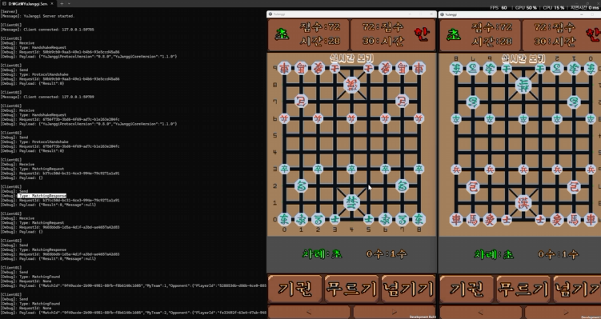

# 👋 Yoo Seokjin

**장기 규칙 엔진부터 TCP 서버 연동·AWS 배포까지 직접 구현한 Unity 클라이언트 개발자입니다.**

## Tech Stack

  
  
  
  
  
  
  

  Input System · UniTask · CancellationToken · DOTween · uGUI · TextMeshPro 
  ScriptableObject · Object Pool · TCP / async / await · MSTest 
  CI/CD · GitHub Actions · UPM / npm / NuGet · AWS EC2 / Ubuntu / systemd

## 대표 프로젝트 — YuJanggi

### 프로젝트 소개 · 시연

로컬·AI·온라인 대국을 지원하는 개인 장기 프로젝트입니다. 
Unity 클라이언트와 규칙 Engine, 공용 Protocol, AWS EC2의 .NET TCP 서버를 연결해 개발하고 있습니다.

### 저장소별 역할

| 프로젝트 | 핵심 역할 |
| --- | --- |
| [YuJanggi.Unity](https://github.com/SeokJinYoo98/YuJanggi.Unity) | 게임 모드별 대국 흐름 · 기보 재생 · 서버 이벤트 반영 |
| [YuJanggi.Engine](https://github.com/SeokJinYoo98/YuJanggi.Engine) | Unity 독립 규칙 엔진 · 합법 수 검증 · 기보 관리 |
| [YuJanggi.Server](https://github.com/SeokJinYoo98/YuJanggi.Server) | AWS EC2 기반 TCP 서버 · 매칭 · 대국 중계 · 리매치 · 채팅 |
| [YuJanggi.Protocol](https://github.com/SeokJinYoo98/YuJanggi.Protocol) | 공용 DTO · 패킷 프레이밍 · Request / Response / Event |

### 핵심 구현

- **게임 흐름 분리**: Local / AI / Network 모드와 Live / Replay 상태에 따라 입력과 화면 갱신을 제어합니다.
- **규칙과 표현 분리**: Unity에 의존하지 않는 Engine에서 이동 후보 생성·합법 수 검증·기보를 처리합니다.
- **비동기 통신**: RequestId로 요청과 응답을 연결하고, 온라인 이동·종료 결과는 서버 Event 수신 후 반영합니다.
- **리매치**: 양쪽 플레이어가 재대결을 요청하면 서버 확정 Event를 받아 대국을 다시 시작합니다.
- **채팅**: 서버가 승인한 메시지를 양쪽에 전달하고, 메시지 길이·전송 간격과 응답 대기 중 중복 전송을 제한합니다.

### CI/CD · 배포

- **PR 검증**: Protocol / Engine / Server의 Restore → Build → MSTest를 GitHub Actions로 구성했습니다.
- **공용 패키지**: Tag 기반으로 패키지를 생성하고, Release Artifact를 GitHub Packages의 NuGet과 npm 레지스트리의 UPM 패키지로 배포합니다.
- **Unity 설치**: Scoped Registry를 통해 npm의 Engine / Protocol 패키지를 설치·갱신합니다.
- **AWS 서버 배포**: Linux x64 Artifact를 AWS EC2에 SSH / SCP로 배포하고, `yujanggi` systemd 서비스를 재시작·확인합니다.
- **배포 인증**: GitHub OIDC를 사용하며, Runner IP에만 SSH를 임시 허용한 뒤 배포 종료 시 해당 규칙을 제거합니다.

### 구현 범위와 남은 과제

**구현**: 로컬·AI·온라인 대국, 매칭·포진, 기보 재생, 리매치, 채팅, 음량 설정 저장 및 AWS EC2 배포 자동화.

**남은 과제**: Engine 기반 서버 이동·최종 결과 검증, 사용자 인증·DB, 이탈 알림·재접속 복구, 모바일 대응.

Engine 규칙·상태, Protocol 직렬화·프레이밍, Server 연결·매칭·대국 흐름에 대한 MSTest를 작성했습니다. 
상세 구조와 실행 방법은 각 저장소의 README에서 확인할 수 있습니다.

## 다른 프로젝트

| 프로젝트 | 사용 기술 · 담당 구현 |
| --- | --- |
| **King of Tank** | C++ / OpenGL · 2인 팀장 · 게임 루프, 렌더링, OBJ 로더, 카메라·미니맵, 충돌 처리 |
| **Phone! Pong!** | UE5 졸업 작품 · Material / Post Processing |
| **오목 AI** | C++ · 후보 탐색과 공격·수비 가중치 계산 · 수강생 토너먼트 12전 전승 |
| **ZomBoogie** | Python / Pico2D · 2D 탑다운 슈팅, AI·충돌·성장 시스템 |
| **DirectX 12 Rendering Framework** | C++ / DirectX 12 학습·실습 · 렌더링 파이프라인, FrameResource, CPU / GPU 동기화 |

[GitHub 기여 활동](https://github.com/SeokJinYoo98?tab=overview) · [전체 저장소](https://github.com/SeokJinYoo98?tab=repositories)
